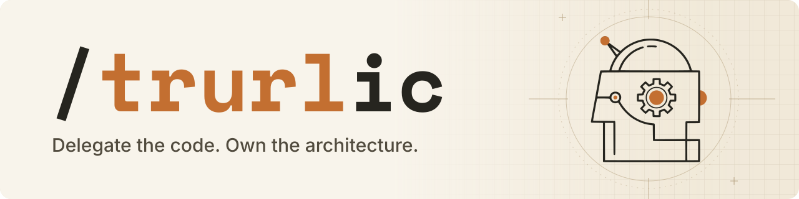

<p align="center">
  
</p>

<p align="center">
  <b>The architecture layer for AI-assisted codebases.</b><br>
  <sub>Named after <a href="https://en.wikipedia.org/wiki/Trurl">Trurl</a> from Stanisław Lem's <b><i>The Cyberiad</i></b>, the constructor who thinks deeply about what he builds before building it.</sub>
</p>

<p align="center">
  <a href="https://github.com/trurlic-labs/trurlic/actions/workflows/ci.yml"></a>
  
  
  <br>
  <a href="https://trurlic-docs.pages.dev/"><b>Documentation</b></a> · <a href="SECURITY.md">Report a vulnerability</a> · <a href="CONTRIBUTING.md">Contributing</a> · <a href="CHANGELOG.md">Changelog</a>
</p>

---

AI coding agents ship fast, but each one makes its own architectural choices — silently, differently, every time. The diffs look fine in isolation. Six months later you have a codebase that works but has no coherent design, and no one can explain why anything is the way it is. The system works. **You just don't own it.**

Trurlic makes you the architect again. Architectural decisions live in a typed graph inside your repo, and **every AI agent receives them as hard constraints before generating a single line** — served over the MCP. One decision graph, every agent follows it, nothing slips through.

## MCP-first

Trurlic is an **MCP server**. Your coding agent — Claude Code or any other MCP client — talks to it directly: it pulls the architectural context of a component or a file before implementing, and records what it decides through `apply`, the one write. The graph is the agent's source of truth: one TOML file per decision and per component, which the agent and you read directly.

The `trurlic` CLI exists for the human: initialize the graph, inspect it, write to it with the same `apply` the agent uses, check it and keep its files in canonical form. **The CLI never calls an LLM.** All reasoning runs on your coding agent's own model.

```
        ┌──────────────┐                      ┌──────────────────┐
  You   │     CLI      │                      │  AI coding agent │
 ──────▶│ init·status  │                      │  context·design  │
        │ apply·check  │                      │  implement       │
        └──────┬───────┘                      └────────┬─────────┘
               │ apply                     MCP read,   │ MCP apply
               ▼                                        ▼
        ┌──────────────────────────────────────────────────────┐
        │   .trurlic/  —  decision graph, one TOML file a node │
        └──────────────────────────────────────────────────────┘
```

## What the agent sees

When an AI coding agent calls `get_context("rate-limiter")`, Trurlic returns:

```
RULES (inviolable: every generated line must respect these):
- ALL error handling MUST use Result<T, AppError>
- ALL persistent state MUST use Redis

COMPONENT: rate-limiter
- Per API key, consistent with auth boundary (...)
- Redis sliding window, 60s buckets (...)
- 429 + retry-after header, RFC 6585 compliant (...) (proposed)
  Code: src/limiter/window.rs::SlidingWindow

RELATED:
- auth: JWT with DPoP, rate limiter runs AFTER auth

OVERRIDE POLICY:
RULES are inviolable. Component decisions are strong defaults:
follow them unless the user explicitly revises them.
Never silently deviate from either.
```

Every decision came from a human decision or an agent proposal marked for review. The agent generates code; the graph constrains it.

## Who decided

Every decision states whether you accepted it.

|  | **`accepted`** | **`proposed`** |
|--|------------|-------------|
| **Recorded when** | You accepted it: set `status = "accepted"` in its file | `apply` records every decision so, the agent's and yours alike |
| **In the brief** | A plain constraint | Marked `(proposed)` until you accept it |

## The files

```toml
# .trurlic/decisions/sign-tokens.toml
component = "auth"
choice = "Sign tokens with Ed25519"
reason = "Verification needs no session store."
alternatives = [
    "HMAC with a shared secret: every verifier could forge tokens",
]
status = "accepted"
created = "2025-06-01T10:30:00Z"
anchors = [
    { file = "src/auth/token.rs", symbol = "sign" },
]
depends_on = [
    "keys-in-the-vault",
]
```

An anchor names a file or directory relative to the project root, and a symbol in it: a `::`-separated path of names from the outermost container, as `Store::open` in Rust or Python, `Config::<Display>::fmt` for a Rust trait impl, `profile::release::panic` for a TOML or JSON key, `Install::From source` for a Markdown heading under its parents, or `ci` for a Makefile target. A bare name such as `sign` is enough when the file defines one thing of that name, and `Store::code_root()` names the function or method alone where a field shares its path. Rust, Python (`.py`, `.pyi`), TypeScript and JavaScript (`.ts`, `.tsx`, `.mts`, `.cts`, `.js`, `.jsx`, `.mjs`, `.cjs`, where a test is named by its `describe` and `it` strings, `Store::opens a file`), C (`.c`) and C++ (`.cc`, `.cpp`, `.cxx`, `.hpp`, `.hh`, and every `.h`), where a symbol is spelled as the source writes it (`Book::operator==`, `Book::~Book`, `Box::get` for a template and its specializations, `Suite::Name` for googletest's `TEST(Suite, Name)`), and those data and prose files are read; a symbol on any other file is reported as one no resolver reads.

The index runs no preprocessor, so it reads every `#if` arm as written. Before a C or C++ file is parsed, the macros the tree itself defines as attributes or specifiers (`LEVELDB_EXPORT`, `FMT_CONSTEXPR`, `CURL_PRINTF(2, 3)`) and as a namespace's opening and closing (`FMT_BEGIN_NAMESPACE`) are blanked, so `class LEVELDB_EXPORT DB {` reads as the class it is. Three things stay unseen: what a function-like macro writes (`BIT(flag);` in a struct defines no field `flag`), a macro defined outside the tree (a system or generated header), which may make the index misread the code around it, and the segments of a namespace a macro opens, which its definitions lack.

The index runs no Rust macro either. A `macro_rules!` macro is a definition, but an item a macro invocation produces is not, whether the macro's body or the invocation's own tokens spell it (`bitflags!`, `proptest!`, `thread_local!`, a crate's own item macros). Anchor such code by an item written outside the invocation (a method in the type's `impl`), by the macro, or by the file. An anchor that names such an item does not resolve, and when an invocation in its file spells the name, the finding says so.

The file stem is the decision's name. A component file holds `description` and `connects_to`. Write them through `apply`, a batch of ops (`record`, `revise`, `rename`, `merge`, `remove`, and the component ops) that lands whole in one commit or not at all, with every edge a rename or a merge touches rewritten; a decision it records is `proposed`. A hand edit is legal too: every load validates it, `trurlic check` reports what is wrong with the graph, and `trurlic fmt` puts each file in its canonical form (sorted sets, one element per line) so branches merge cleanly.

## Quality rules

`apply` refuses a decision below the bar, naming the field, the rule, the measured value and the limit (`ops[0].reason`: `190 words, over the maximum of 180`). Built in: a choice is one line of at most 200 bytes, a reason is real text of at least 10 bytes, neither holds an invisible, reordering or control character, and a decision has at least one alternative and one anchor. A project adds its own in `.trurlic/project.toml`; every key is optional:

```toml
[quality]
reason_words = { min = 30, max = 180 }   # words of a reason
alternatives_max = 4                      # alternatives of a decision
alternative_words_max = 30                # words of each alternative
anchors_max = 8                           # anchors of a decision
require_origin = true                     # a batch that records a decision names its origin

[[quality.patterns]]
pattern = '(?i)(?:^|\W)(?:we|our)(?:\W|$)'  # a regular expression (Rust regex syntax)
fields = ["choice", "reason", "alternatives"]  # also tags, anchors, origin
level = "refuse"                          # or "warn": written, with a warning in the result
message = "The subject is a code entity, never \"we\"."
```

A word is a run of text between whitespace. Patterns run on a lazy DFA, compiled before a write takes its lock. A Unicode word boundary (`\b`, `\B`) is refused, so write a whole word as `(?:^|\W)word(?:\W|$)` (or `(?-u:\b)` over ASCII text); so are case-insensitive classes that fold more than 2,097,152 code points (`(?i)[\s\S]` twice) and an automaton that cannot start within its cache (`\w{9}`), each naming the pattern and the rewrite. Each pattern charges the bytes of the texts it reads before it reads them, and builds its automaton in a cache of 320 KiB that gives up when full; a batch past 100 MB is refused at that op as `pattern_work`, one over whose texts a pattern's cache fills as `pattern_gave_up`, and one whose patterns' caches grow past 1.5 MiB together as `pattern_cache_total`, naming the pattern that grew the most; split the batch, or simplify the pattern. An op is held to the bar only in the fields it changes, so a decision migrated or edited below the bar stays revisable, and a field it writes must meet the bar whole. A `warn` pattern warns once per op at its first match: the result lists one warning per op in `warnings`, by argument, pattern index and byte offset, counts the rest in the op's `more_warnings`, and carries each named pattern's message once in `patterns`; `trurlic apply` prints them on stderr. The bar refuses writes alone: `trurlic check` reports the text rules of every file, not the bar, and fails when a pattern does not compile, which would refuse every write. `trurlic status` counts the rules the table sets and shows, under `lint`, every limit of the bar a stored decision breaks, with the field, the measure and the bound: the graph below its own bar, never an error. `trurlic status --section lint` judges the patterns too, a `warn` pattern's included, over the decisions by name while the bytes they read stay within a bound and the result has room; a pattern whose cache fills, or caches that grow past 1.5 MiB together, end the page before that decision, and one fresh caches cannot judge is listed as `pattern_gave_up` or `pattern_cache_total`. It counts the decisions it left unjudged and names in `next` where the page ended; `--from <name>` reads on from there. It lists there too each decision whose anchors all name a file and no symbol, none of which says what part of its file the decision constrains. [`examples/quality.toml`](examples/quality.toml) is a complete bar for decisions that coding agents follow.

A likely duplicate is a warning, never a refusal. Two decisions are likely duplicates when the TF-IDF cosine of their `choice` and `reason` is 0.5 or more: the terms are lowercased runs of ASCII letters and underscores, two characters or more, starting with a letter, less 35 common stop words, weighted by count times ln((1 + n) / (1 + df)) + 1 over the graph's n decisions. `apply` names, in `duplicates`, each decision whose choice or reason the batch wrote with its three nearest, looked for once the write has released its lock, and `trurlic apply` prints them on stderr. `status` lists the pairs under `lint` a page at a time: a term many decisions hold pairs most of them, so the work of each step is counted before it runs, and a page probes the decisions by name while it fits a fixed bound, each pair on the page of the later-named of its decisions; `counts.lint.pairs.next` names where `section: "lint"` with `from` reads on. Within a page the pairs come best first. Past the bound `apply` looks for none and says so in `duplicates_unsought`. Scores are computed in integers, so every machine reports the same pairs and the same six decimals.

## Where the graph lives

`trurlic init --placement tracked` puts `.trurlic/` under the project's git: it is committed with the code, and every worktree and clone carries its own. `--placement shared` keeps it out of git (through `.git/info/exclude`): one graph at the top of the main worktree serves every linked worktree, and a clone or a copy outside the repository reaches it through a symlink named `.trurlic`:

```bash
ln -s /path/to/project/.trurlic .trurlic   # in the clone's root
```

Every command and the MCP server find the graph from the directory they run in, and resolve anchors against that tree, not against the graph's. `trurlic status` names both when they differ. `trurlic check` fails when git contradicts the placement (a tracked graph git does not track or ignores, a shared one git tracks) and when a worktree carries a second graph beside a shared one.

History: a tracked graph's history is the project's git, and trurlic never commits to it. A shared graph is a git repository of its own, `.trurlic/.git`, which `init` makes: every write is one commit there, named after the command, with `Origin:` and `Session:` trailers when the write has them, and edits made by hand are committed first as `hand edit`. Read it with git:

```bash
git -C .trurlic log --stat
```

`trurlic fmt` commits what you edited by hand; `trurlic check` and `trurlic status` say when the history lacks a file or a stopped git left `.trurlic/.git/index.lock` behind. A shared graph needs `git` on `PATH`.

## Install

```bash
curl -fsSL https://raw.githubusercontent.com/trurlic-labs/trurlic/master/install.sh | bash
```

Or with Rust: `cargo install trurlic` (requires Rust 1.90+).

Pre-built binaries for Linux, macOS, and Windows are on the [Releases](https://github.com/trurlic-labs/trurlic/releases) page.

## Connect your agent

`trurlic install` registers the MCP server with Claude Code for your user, through `claude mcp add` (`--dry-run` prints that command instead of running it):

```bash
trurlic install --ide claude-code
```

Any other MCP client: add this to its MCP config:

```json
{
  "mcpServers": {
    "trurlic": {
      "command": "trurlic",
      "args": ["serve"]
    }
  }
}
```

Then tell your agent how to use it — add to `CLAUDE.md` or your agent's equivalent:

```markdown
## Trurlic

This project uses Trurlic for architectural decisions.

Before implementing any task:
1. Call `get_context` for the component, or `get_decisions_for_file` for
   the files you will edit, and read every decision: they constrain the
   code you write.
2. Implement within them. For a choice no decision covers, search
   `.trurlic/decisions/`; if none covers it, record it with the `apply`
   tool: it is `proposed` until the user accepts it.
3. Before committing, run `trurlic check`.
```

See [CLAUDE.md](CLAUDE.md) for the full recommended instructions.

## Quick start

Two commands set it up; everything else is a conversation with your agent.

```bash
trurlic init --placement tracked   # create the graph in your project root, versioned by its git
trurlic install --ide claude-code  # wire up your coding agent over MCP
```

**Designing something new?** Talk it through:

> Let's design the rate limiter, and write each decision we agree on to Trurlic.

The agent reasons it out with you and records each decision you agree on through `apply`, as `proposed`; you accept the ones that are yours by setting `status = "accepted"` in their files. Then it implements against the constraints it just captured.

**Implementing within what already exists?** Just say what you want:

> Add per-key rate limiting to the auth service.

Before writing a line, the agent pulls the component's brief and generates code that respects every decision.

```bash
trurlic status              # the graph at a glance: counts, issues, history, components, lint
trurlic status --section anchors  # the anchors that do not plainly resolve in this tree
trurlic apply batch.json    # a batch of ops, the JSON the apply tool takes, all or none
trurlic check               # every issue and anchor finding; fails on an issue, a stale, malformed or ambiguous anchor
trurlic fmt                 # rewrite the files that are not in canonical form
```

## Documentation

Full documentation lives at **[trurlic-docs.pages.dev](https://trurlic-docs.pages.dev/)**:

- **[Start here](https://trurlic-docs.pages.dev/)** — overview, setup, and the core concepts
- **[Architecture](https://trurlic-docs.pages.dev/)** — system design and the integrity model
- **[Guides](https://trurlic-docs.pages.dev/)** — the MCP server, configuration, and design workflows
- **[Reference](https://trurlic-docs.pages.dev/)** — full CLI reference, MCP tools, and troubleshooting
- **[Integrations](https://trurlic-docs.pages.dev/)** — connecting Claude Code and other MCP clients

## How the agent works with the graph

Every task starts from the component's brief. The agent reads it, implements within it, and writes down any choice the graph does not cover yet.

```
get_context(component)                →  decisions + rules + related constraints
get_decisions_for_file(path)          →  the decisions anchored on a file or directory
  … agent implements within the brief …
apply({ops: [{op: "record", ...}]})   →  a choice the graph did not cover yet
trurlic check                         →  no issue
```

## Anchor findings

`trurlic check` resolves every anchor against the tree it runs in and reports each one that does not plainly resolve, with its cause:

| Finding | When | `check` |
|---|---|---|
| `stale` | No file at its path, or no definition its symbol names, on an accepted decision or a proposed revision of one, and no other worktree holds it | error: fails |
| `malformed` | Its symbol is out of the grammar of its file's kind, or on a directory, so it can never resolve as written, whatever the decision's status | error: fails |
| `ambiguous` | Its symbol names definitions of several paths (`pages` with `Book::pages` and `Shelf::pages`), so a reader cannot tell which one the decision means | error: fails |
| `unverified` | Its symbol is on a kind of file no resolver reads, or on a file that cannot be read or indexed: the code may exist, but trurlic cannot say | warning |
| `weak` | Its symbol is one name that 10 or more code files of its kind define, and it is not the whole path of what it names (`run` for `Runner::run`): a module-level item named by its own name never is | warning |
| `pending` | It would be stale, but another worktree of the repository resolves it, one whose work tree differs at the anchor's file from where its line forked from this tree's (committed there, edited and not committed, or a new file not yet added) and where the fork did not resolve it, so code this tree deleted since is never pending. It is named with its branch. Only that file is read there | note |
| `planned` | No file at its path or no definition its symbol names, on a decision never accepted, which may anchor what is not written yet | note |

A worktree whose work tree matches the fork at the anchor's file, such as one of an older branch or of a branch that left the file alone, makes nothing pending, and a worktree git cannot say enough of is a warning. A symbol that names one place's definitions of several kinds, a field and its getter, is no finding. A stale anchor shows its repair only when git's history shows its code itself there: the same tokens, comments and whitespace aside, by span hash, nothing else tolerated, not a changed visibility or attribute. A file git reports renamed (committed on the current branch, or `git mv`-ed), followed through each rename the next commit that changed its new path made, and given up when that commit deleted or copied it, carries a symbol anchor whose code is the same before the rename and in the file the rename made, and whose symbol still names definitions of those kinds there, however the file was edited since; it carries a file anchor when the rename is exact, or one of its symbol anchors followed it and, for an inexact rename, none that resolved in the old file is missing from the new one. Else a symbol of a Rust file is searched for in exactly one other file of the same target by place (the library, `src/main.rs` and every module under `src/` are one target; each `src/bin`, `tests`, `benches` and `examples` target is its own; a manifest's `path =` is not read) that writes it as its whole path, never a re-export or a `mod` declaration, and not while a macro invocation of the searched file spells the name; a file of another language is not searched. The move must be one step: the commit where the anchor's file, or the file a rename carried the symbol into, last lost an item of the symbol (looked for among its 16 newest commits), or the work tree, gave that other file the same code, which it did not write before, and no later commit deleted or added that file. `apply` with `{"op": "repair_anchors"}` writes every repair `check` shows, or the `repairs` you list, and leaves each decision's status alone; with no `repairs`, each repair is held to the tree once more under the write lock, a repair the `[quality]` bar refuses or cannot judge is left, the rule its cause, and the rest are written, while a listed repair a pattern refuses refuses the batch, naming the decision. `status` with `section: "anchors"` asks the project's git nothing, so it reports what this tree alone shows: `unresolved` for an anchor that would be stale or pending, `malformed`, `ambiguous`, `unverified` and `weak`. It computes the section only when asked for it, since it reads every source file of the tree, and `origin` narrows it to the decisions recorded under it.

## MCP tools

| Tool | Purpose |
|------|---------|
| `apply` | The one write: a batch of ops applied in order, all or none, in one commit; a refusal names the op, the argument and the rule; held to the [quality rules](#quality-rules) |
| `status` | The graph at a glance: counts, the quality rules `[quality]` sets, validation issues, what a shared graph's history lacks, each component's decisions, and under `lint` the likely duplicate pairs, each rule of the bar a decision breaks and the decisions with only file anchors; asked for, the [anchor findings](#anchor-findings) |
| `get_context` | Architectural brief for a component: decisions, rules, related constraints, health |
| `get_decisions_for_file` | Every decision anchored on a file, on a file under a directory, or on a directory that holds the file |

`apply` and `status` declare an `outputSchema` and return `structuredContent` with the same JSON as text; each has a CLI twin on the same code (`trurlic apply <file>`, `trurlic status`, `--json` for the tool's JSON). Every result fits 24 KiB, which Claude Code shows inline. A `status` section that does not fit says how many items it left out and where they are; any other larger answer keeps its shape: its longest lists and strings lose their tails, and a `truncated` array names each cut with what it omitted.

All tools carry [annotations](https://modelcontextprotocol.io/specification/2025-11-25/server/tools#annotations) (`readOnlyHint`, `destructiveHint`, `openWorldHint`) so MCP clients can reason about each invocation.

## Development

```bash
make setup        # install the git hooks
make ci           # fmt + clippy + test + audit (run before pushing)
```

See [CONTRIBUTING.md](CONTRIBUTING.md) for the full development guide.

## License

Apache-2.0
